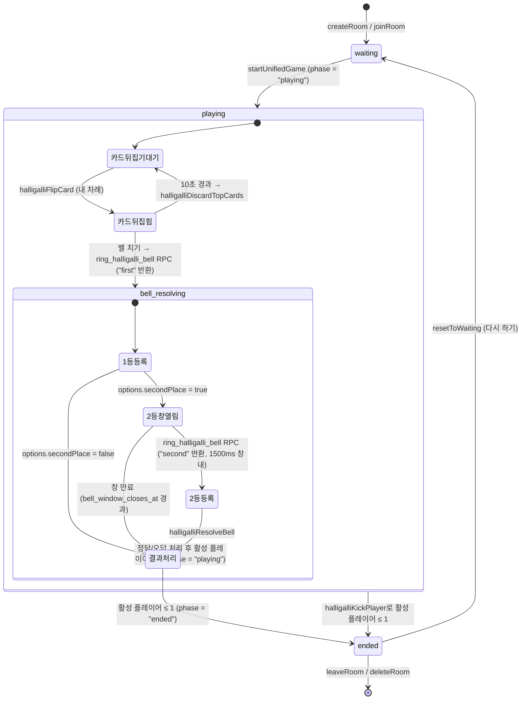

# HalliGalli 기획서

> 이 문서는 기존 코드를 역분석해 자동 생성됐습니다. 필요시 직접 수정하세요.

## 개요

- 플레이어 수: 2~6명 (방 최대 `MAX_PLAYERS = 6`)
- 게임 목표: 과일 카드를 뒤집어 같은 종류의 과일이 정확히 5개가 되면 벨을 쳐서 테이블 위의 모든 카드를 가져온다. 카드를 가장 많이 모은 플레이어가 승리하며, 카드가 없는 플레이어는 탈락한다.
- 활성 플레이어가 1명 이하가 되면 게임 종료.

---

## 덱 구성

- 총 60장: 과일 4종(`strawberry` 딸기 / `banana` 바나나 / `lime` 라임 / `plum` 자두) × 14장(분포: 1×3, 2×3, 3×3, 4×2, 5×3) + 조커 4장
- 조커(`fruit: 'joker'`)는 모든 과일 수에 각각 +1로 계산된다.
- 시작 시 덱을 셔플하고 플레이어 수로 균등 분배 (나머지 버림).

---

## 규칙

### 턴 구조

1. 현재 턴 플레이어가 자신의 덱 맨 위 카드를 뒤집어 자신의 공개 슬롯에 놓는다 (`halligalliFlipCard`).
2. 카드를 뒤집으면 타이머가 10초 리셋된다. 10초 안에 아무도 벨을 치지 않으면 모든 공개 카드를 버린다.
3. 다음 턴 플레이어로 넘어간다.

### 가능한 행동

| 행동 | 조건 | 설명 |
|------|------|------|
| 카드 뒤집기 | `phase === 'playing'` && 내 차례 | 덱에서 카드 1장을 공개 슬롯에 올린다 |
| 벨 치기 | `phase === 'playing'` | 아무 플레이어나 언제든 벨을 칠 수 있다 |
| 2등 벨 | `options.secondPlace === true` && `phase === 'bell_resolving'` && 1등과 다른 플레이어 | 1등 등록 후 1500ms 창 안에 2번째로 치면 2등 등록 |

### 벨 처리

- 벨을 처음 친 플레이어가 `bell_winner`로 등록되고 `phase`가 `bell_resolving`으로 전환된다 (Supabase `ring_halligalli_bell` RPC — row-level lock으로 동시성 처리).
- `options.secondPlace` 옵션이 켜진 경우 1500ms 창(`bell_window_closes_at`)이 열리고, 그 안에 두 번째로 벨을 치면 `second_bell_winner`에 등록된다.
- 창이 닫히거나 2등이 등록되면 `halligalliResolveBell`이 호출된다.

### 승리/패널티 조건

| 경우 | 처리 |
|------|------|
| 정답 벨 (공개 카드 중 동일 과일 합계 = 5) | `actualWinner`(2등 옵션 켜졌을 때 `second_bell_winner`, 아니면 `bell_winner`)가 테이블의 모든 공개 카드 획득 |
| 오답 벨 | `bell_winner`가 각 생존 플레이어에게 자신의 덱에서 1장씩 제공 |
| 10초 타임아웃 | 모든 공개 카드 버림 (버림 덱으로 가지 않고 그냥 제거) |

### 탈락 조건

- 덱 카드 + 공개 카드 합계가 0장인 플레이어는 `eliminated` 배열에 추가된다.
- 오프라인 플레이어가 차례를 연속 3회 스킵당하면 호스트가 강퇴(`halligalliKickPlayer`)한다.

### 승리 조건

- 활성 플레이어가 1명 남으면 `phase === 'ended'`, `winner_id`에 최종 생존자 기록.
- 결과 화면에서는 `eliminated` 배열 역순(나중에 탈락할수록 상위)으로 순위를 계산하고, 미탈락자는 `card_counts` 내림차순으로 정렬.

---

## game_state 구조

`startUnifiedGame`의 `halligalli` 분기 초기화 코드 기반 실제 JSON 예시 (플레이어 2명):

```json
{
  "selected_game": "halligalli",
  "phase": "playing",
  "decks": {
    "player-uuid-1": [
      { "fruit": "strawberry", "count": 3 },
      { "fruit": "banana", "count": 1 }
    ],
    "player-uuid-2": [
      { "fruit": "lime", "count": 5 }
    ]
  },
  "top_cards": {
    "player-uuid-1": null,
    "player-uuid-2": null
  },
  "turn_order": ["player-uuid-1", "player-uuid-2"],
  "turn_index": 0,
  "turn_started_at": 1700000000000,
  "last_flip_at": null,
  "bell_winner": null,
  "second_bell_winner": null,
  "bell_window_closes_at": null,
  "bell_correct": null,
  "last_bell_winner_id": null,
  "last_bell_second_winner_id": null,
  "card_counts": {
    "player-uuid-1": 30,
    "player-uuid-2": 30
  },
  "eliminated": [],
  "winner_id": null,
  "options": {
    "secondPlace": false,
    "autoFlip": false,
    "autoFlipSeconds": 5
  }
}
```

### 필드 설명

| 필드 | 타입 | 설명 |
|------|------|------|
| `selected_game` | string | `"halligalli"` 고정 |
| `phase` | string | `"playing"` \| `"bell_resolving"` \| `"ended"` |
| `decks` | `{[playerId]: Card[]}` | 각 플레이어의 손패(덱). 맨 앞(`shift()`)이 다음에 뒤집힐 카드 |
| `top_cards` | `{[playerId]: Card \| null}` | 현재 테이블에 공개된 카드. `null`이면 미공개 |
| `turn_order` | `string[]` | 셔플된 플레이어 ID 순서 |
| `turn_index` | number | 현재 턴 플레이어의 `turn_order` 인덱스 |
| `turn_started_at` | number (ms) | 현재 턴 시작 시각 (자동 뒤집기 카운트다운 기준) |
| `last_flip_at` | number \| null (ms) | 마지막 카드 뒤집기 시각 (10초 타임아웃 기준) |
| `bell_winner` | string \| null | 1등으로 벨을 친 플레이어 ID |
| `second_bell_winner` | string \| null | 2등으로 벨을 친 플레이어 ID |
| `bell_window_closes_at` | number \| null (ms) | 2등 창 마감 시각 |
| `bell_correct` | boolean \| null | 가장 최근 벨의 정답 여부 (오버레이 표시용) |
| `last_bell_winner_id` | string \| null | resolve 완료 후 기록된 1등 ID (오버레이 표시용) |
| `last_bell_second_winner_id` | string \| null | resolve 완료 후 기록된 2등 ID |
| `card_counts` | `{[playerId]: number}` | 덱 + 공개 카드 합산 보유 수 |
| `eliminated` | `string[]` | 탈락된 플레이어 ID 목록 (탈락 순서대로 push) |
| `winner_id` | string \| null | 최종 승자 ID (`phase === 'ended'`일 때 기록) |
| `options.secondPlace` | boolean | 2등 벨 옵션 |
| `options.autoFlip` | boolean | 자동 뒤집기 옵션 |
| `options.autoFlipSeconds` | number | 자동 뒤집기 대기 초 (기본 5) |

### Card 객체

```json
{ "fruit": "strawberry", "count": 3 }
```

- `fruit`: `"strawberry"` \| `"banana"` \| `"lime"` \| `"plum"` \| `"joker"`
- `count`: `1`~`5` (조커는 항상 `1`이지만 모든 과일에 +1로 처리)

---

## 서비스 함수 목록

### `src/services/games/supabaseTyping.js` — 할리갈리 관련 export

| 함수명 | 파라미터 | 역할 |
|--------|----------|------|
| `startUnifiedGame` | `roomId, 'halligalli', players, options` | 덱 생성·분배 후 초기 `game_state` 저장, 방 `status`를 `'playing'`으로 전환 |
| `halligalliFlipCard` | `roomId, playerId` | 현재 턴 플레이어의 덱 맨 위 카드를 `top_cards`로 이동, `turn_index` 진행, `last_flip_at` 갱신 |
| `halligalliRingBell` | `roomId, playerId` | Supabase RPC `ring_halligalli_bell` 호출. 반환값: `'first'` \| `'second'` \| `'late'` |
| `halligalliResolveBell` | `roomId` | 벨 정답 판정 → 카드 획득/패널티 처리, 탈락 체크, `phase` 전이 |
| `halligalliDiscardTopCards` | `roomId` | 10초 타임아웃 시 모든 공개 카드 버림 (호스트 클라이언트가 호출) |
| `halligalliKickPlayer` | `roomId, playerId` | 오프라인 플레이어 강퇴 (호스트 전용). `eliminated`에 추가 후 턴 이전 |

### `src/utils/games/halliGalliGameLogic.js` — 순수 로직 함수

| 함수명 | 파라미터 | 역할 |
|--------|----------|------|
| `buildDeck` | — | 60장 덱 생성 후 셔플 반환 |
| `dealCards` | `playerIds: string[]` | 덱을 플레이어 수로 균등 분배. `{ decks, top_cards }` 반환 |
| `getFruitCounts` | `topCards` | 공개 카드 전체의 과일별 합산 수 반환 (조커 처리 포함) |
| `checkBellCondition` | `topCards` | 동일 과일 합계가 정확히 5인 경우 `true` 반환 |
| `collectCards` | `state, winnerId` | 정답 벨: 모든 공개 카드를 `winnerId` 덱 뒤에 추가, `top_cards` 초기화 |
| `penalizeWrongBell` | `state, loserId` | 오답 벨: `loserId` 덱 앞에서 1장씩 각 생존 플레이어에게 이전 |
| `discardTopCards` | `state` | 타임아웃: 모든 공개 카드 제거 |
| `advanceTurn` | `state, fromIndex` | `fromIndex`에서 다음 활성(비탈락) 플레이어 `turn_index` 계산 |

### `src/services/games/supabaseTyping.js` — 방 관리 (할리갈리 포함 통합)

| 함수명 | 파라미터 | 역할 |
|--------|----------|------|
| `createRoom` | `hostName, userId?` | 방 생성 + 호스트 플레이어 등록 |
| `joinRoom` | `code, playerName, userId?` | 코드로 방 입장 (최대 6명 체크) |
| `getRoomPlayers` | `roomId` | 방의 플레이어 목록 조회 |
| `getRoomData` | `roomId` | 방 정보(상태, `game_state` 포함) 조회 |
| `leaveRoom` | `playerId` | 플레이어 퇴장 (행 삭제) |
| `deleteRoom` | `roomId` | 방 삭제 |
| `promoteToHost` | `playerId` | 호스트 승격 |
| `resetToWaiting` | `roomId` | 게임 종료 후 대기 상태 복원 |
| `subscribeToRoom` | `roomId, onUpdate, onRoomDeleted` | `typing_rooms` / `typing_players` 실시간 구독 |
| `unsubscribeFromRoom` | `channel` | 구독 해제 |

---

## 파일 구조

```
src/
  utils/games/
    halliGalliGameLogic.js        # 순수 게임 로직 (덱, 벨, 카드 이동)
  services/games/
    supabaseTyping.js             # 방 관리 + 할리갈리·블로커스·터이네키아·코브라 통합 서비스
  components/games/halligalli/
    HalliGalliPlay.jsx            # 게임 플레이 UI 컴포넌트
    HalliGalliPlay.css            # 스타일
```

> `HalliGalliGame.jsx` (방 대기·입장 로직)은 별도 파일이 아니라 다른 게임과 공유하는 통합 방 컴포넌트를 사용하는 것으로 추정됨. (파일 미존재 확인)

---

## 게임 흐름도



### phase 전이 요약

| 전이 | 트리거 | 조건 |
|------|--------|------|
| `waiting` → `playing` | `startUnifiedGame` | 호스트가 게임 시작 |
| `playing` → `bell_resolving` | `ring_halligalli_bell` RPC | 플레이어가 벨을 치고 `bell_winner`가 null인 상태 |
| `bell_resolving` → `playing` | `halligalliResolveBell` | 벨 처리 완료 & 활성 플레이어 ≥ 2 |
| `bell_resolving` → `ended` | `halligalliResolveBell` | 벨 처리 완료 & 활성 플레이어 ≤ 1 |
| `playing` → `ended` | `halligalliKickPlayer` | 강퇴 후 활성 플레이어 ≤ 1 |
| `ended` → `waiting` | `resetToWaiting` | 다시 하기 |

---

## 옵션

| 옵션 키 | 타입 | 기본값 | 설명 |
|---------|------|--------|------|
| `secondPlace` | boolean | `false` | 1등 벨 후 1500ms 창 내에 2등 벨 허용. 2등이 등록되면 2등이 카드를 가져감 |
| `autoFlip` | boolean | `false` | 내 차례에 `autoFlipSeconds` 초 안에 뒤집지 않으면 자동 뒤집기 |
| `autoFlipSeconds` | number | `5` | 자동 뒤집기 대기 시간(초) |

---

## 수동 보완 필요 항목

아래 항목들은 코드에서 명확히 파악되지 않아 직접 확인·보완이 필요합니다.

1. **방 대기/입장 UI 컴포넌트 경로**: `HalliGalliGame.jsx`가 존재하지 않음. 블로커스, 코브라 등과 공유하는 통합 방 컴포넌트가 있을 것으로 추정되나, 실제 파일명/경로 미확인.
2. **App.jsx 라우트**: 할리갈리 진입 경로(예: `/halligalli`, `/mini-arcade/halligalli` 등)가 어떻게 등록됐는지 확인 필요.
3. **`resetToWaiting` vs 다시 하기 플로우**: `HalliGalliPlay.jsx`의 `onResetGame` 콜백이 실제로 어느 함수를 호출하는지 상위 컴포넌트 코드 확인 필요.
4. **Supabase RPC `ring_halligalli_bell` 배포 여부**: 함수 정의가 `supabaseTyping.js` 주석에만 존재. 실제 Supabase 프로젝트에 배포됐는지 확인 필요.
5. **버림 카드 처리**: `discardTopCards`는 공개 카드를 단순 `null`로 초기화하며 버림 더미 덱 없이 제거함. 의도적인 단순화인지 확인 필요.
6. **조커 카드 UI 렌더링**: `FRUIT_GRID`에 조커 항목 없이 별도 분기 처리됨. 카운트 표시 방식(ALL 텍스트) 외 추가 의도된 시각 효과 여부 확인 필요.
